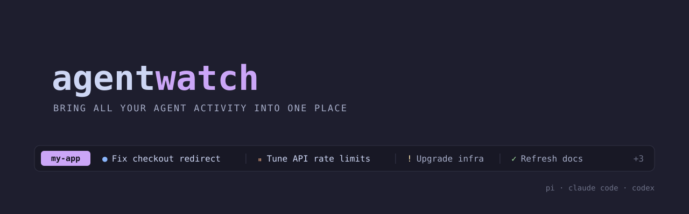
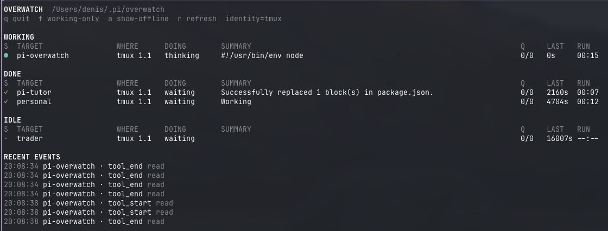

# agentwatch

<picture>
  <source media="(prefers-color-scheme: dark)" srcset="assets/banner-dark.svg">
  <source media="(prefers-color-scheme: light)" srcset="assets/banner-light.svg">
  
</picture>

```bash
pi install npm:agentwatch
```

Minimal observability for your coding harnesses.

I built `agentwatch` because I wanted a simple way to see what my coding sessions were doing while multitasking.

I use tmux with a "one session per project" setup, so agentwatch uses the tmux session name as the main target label when the agent is running inside tmux. If you're not using tmux, it falls back to the directory where you launched it.

Supported harnesses:

- **Pi** — installed as an extension
- **Claude Code** — installed as hooks, see [Claude Code](#claude-code)
- **Codex** — installed as hooks, see [Codex](#codex)

The dashboard doesn't care which one wrote a state file, so they share one view, one status line, and one keybinding.

There are already agent control-center tools and tmux dashboards out there, but I wanted something smaller and calmer: a lightweight TUI that gives me live status for my harnesses without changing how I work.

You can run it anywhere in your terminal setup — inside a tmux pane, in a separate terminal window, or in something like Ghostty.

## Demo

[](https://www.youtube.com/watch?v=Y33AkG2fl8Q)

Watch the demo video on YouTube:

- https://www.youtube.com/watch?v=Y33AkG2fl8Q

## Screenshot



## What it shows

- current session status at a glance, whichever harness it is
- tmux-session-aware target labels
- cwd fallback when tmux is not available
- current phase or tool activity
- which sessions are blocked waiting on you
- queue counts, heartbeat age, and runtime
- stale-session detection
- simple local config in `~/.local/state/agentwatch/config.json`

## Demo
https://github.com/user-attachments/assets/fda9077b-3a37-4d1a-8adc-827d17dc7f53

## Install

### From npm

```bash
pi install npm:agentwatch
```

### From GitHub

```bash
pi install https://github.com/denismrvoljak/agentwatch
```

### Project-local install

```bash
pi install -l npm:agentwatch
```

### One-off test

```bash
pi -e npm:agentwatch
```

## Run agentwatch

Open another terminal pane or window and run:

```bash
agentwatch
```

If you want to run it directly from the repo:

```bash
node /absolute/path/to/agentwatch/bin/agentwatch.js
```

## How targeting works

agentwatch is tmux-aware, not tmux-dependent.

Target resolution is:

1. tmux session name
2. agent session name
3. cwd basename

That means if you use a tmux workflow like "one tmux session per project", the dashboard naturally follows that naming. If you are not using tmux, it still works fine and identifies sessions from the directory where the agent was launched.

## Dashboard columns

- `S` — status icon
- `SRC` — which agent produced the row (`π` Pi, `✳` Claude Code, `◇` Codex)
- `TARGET` — main identity for the agent
- `WHERE` — source context, usually tmux pane info like `tmux 1.1`
- `DOING` — current phase or tool
- `SUMMARY` — short activity summary
- `Q` — steering/follow-up queue counts
- `LAST` — seconds since last heartbeat
- `RUN` — elapsed runtime for the current or most recent task

Status icons:

- `●` working
- `⏸` blocked — waiting on you; `DOING` says on what (`permission`, `question`, `auth`)
- `✓` done
- `!` stale — claimed to be working, then went silent
- `✕` error
- `○` offline

## Program status (OSC 7501)

agentwatch statuses follow the [program status protocol](https://mitchellh.com/writing/program-status-osc7501) ([spec](https://www.superlogical.com/rex/docs/build/program-status)), so a state means the same thing in the dashboard as it does to a terminal that supports it.

| agentwatch | OSC 7501 | Notes |
| --- | --- | --- |
| `idle` | `idle` | waiting for your next instruction |
| `working` | `working` | `progress` (0–100) is shown when a producer sets it |
| `blocked` | `blocked` | with `kind`: `permission`, `question`, or `auth` |
| `done` | `done` | |
| `error` | `error` | |
| `offline` | `clear` | the session ended, or its process is gone |
| `stale` | — | agentwatch only: computed by the dashboard, never reported |

The `SRC` tool maps to `app` (`pi`, `claude-code`, `codex`), the target label to `title`, and the summary to `msg`.

A record lasts as long as its agent. It is removed when the agent reports that it is shutting down (Pi's `session_shutdown`, `SessionEnd` in Claude Code and Codex), or when the dashboard finds that the agent's process no longer exists, which covers crashes and killed terminals. Hooks record the pid of the `claude` / `codex` process (or the `node` running it), not of the short-lived hook.

### Report status to your terminal

Opt in, and agents also report their status to the terminal they run in:

```json
{
  "programStatus": {
    "emit": true
  }
}
```

Each agent reports under its own record `id`. Terminals ignore OSCs they do not understand, so this is safe on any terminal. Pi writes to its own terminal; Claude Code and Codex hooks have no terminal of their own, so they write to the tty of the agent process.

Inside tmux, reports are wrapped in tmux passthrough and only reach the outer terminal with `set -g allow-passthrough on`. With `on`, tmux forwards them only from visible panes; use `all` to also forward from panes in other windows and sessions. The outer terminal sees one tmux client, so the per-agent `id` is what keeps agents apart there.

Status still flows one way: terminals cannot be asked for the records they hold, so the dashboard and tmux row keep reading agentwatch's own state files.

To check whether your terminal supports the protocol, run this outside tmux. A supporting terminal answers with `?`:

```bash
printf '\e]7501;?\e\\'; read -rs -t 1 -d '\' reply; printf '%q\n' "$reply"
```

## Claude Code

agentwatch also tracks Claude Code sessions in the same dashboard and statusline. The dashboard does not care what produced a state file, so both agents share one view, one tmux binding, and one status line.

Install the hooks:

```bash
agentwatch install-claude-hooks
```

Flags:

- `--project` — write to `./.claude/settings.json` instead of `~/.claude/settings.json`
- `--dry-run` — print the resulting settings without writing
- `--uninstall` — remove agentwatch hooks again

The command is idempotent, backs up the previous file to `settings.json.overwatch-backup`, and leaves any other hooks you already have configured untouched. Restart Claude Code afterwards.

Claude Code waits for each hook before continuing, so the hook only writes the state file and returns. tmux status refreshes, notifications, and the bell run in a detached process, which keeps a slow tmux server from stalling your prompt. Installed hooks get a 10s timeout as a backstop; re-run `agentwatch install-claude-hooks` after upgrading to pick it up.

Rows are tagged by source in the `SRC` column and in the statusline:

- `π` — Pi
- `✳` — Claude Code
- `◇` — Codex

Hide the tag in the statusline with `--no-source`, or filter to one agent with `--source pi` / `--source claude-code` / `--source codex`.

### How it differs from the Pi extension

Pi runs agentwatch as a long-lived extension, so it can heartbeat every 5 seconds. Claude Code has no such process — each hook is its own short-lived invocation — so there is nothing to heartbeat from. Instead the Claude Code producer writes a `staleMs` field on its own state, and the dashboard honours that per agent rather than applying the global `AGENTWATCH_STALE_MS`. Default is 3 minutes; change it with `claudeCode.staleMs` in the config.

Claude Code also exposes a signal Pi does not: it fires `Notification` when it blocks on a permission prompt. Those rows get the `blocked` status with kind `permission`, their own group and a `⏸` icon, and trigger a tmux message when the pane is not visible, since an agent waiting on you is the thing most worth surfacing.

The same hook also fires on a plain idle timeout roughly a minute after Claude has already stopped, which means the two cases must be told apart by message text — treating an idle ping as activity resurrects a finished session into `working`, where it then goes stale and shows `!`. Only a message matching a permission prompt sets `blocked`; an idle one leaves a finished status alone; an unrecognised one changes no status at all.

Relatedly, `stale` now means "claimed to be working, then went silent". An agent blocked on a human is not stale no matter how long it sits there, so `blocked` rows and anything with phase `waiting` are exempt from the stale window.

### Hook mapping

| agentwatch state | Claude Code hook |
| --- | --- |
| session registered, `idle` | `SessionStart` |
| `working` / `thinking` | `UserPromptSubmit` |
| `working` / `tool` | `PreToolUse` |
| back to `thinking`, or `error` | `PostToolUse` |
| `blocked` (`permission`), or idle-with-no-change | `Notification` |
| `done` + tmux notify | `Stop` |
| `offline` | `SessionEnd` |

## Codex

Codex hooks use the same event names and payloads as Claude Code, so Codex rows come from the same producer.

```bash
agentwatch install-codex-hooks
```

This writes `~/.codex/hooks.json` (or `./.codex/hooks.json` with `--project`) and takes the same `--dry-run` and `--uninstall` flags. Codex asks you to review new hooks before it runs them, so restart Codex and approve them in `/hooks`. Hooks need Codex's `hooks` feature, which is on by default in current releases.

Codex reports approval prompts through a dedicated `PermissionRequest` event, so blocked rows need no message matching. It also fires `Interrupt` when you stop a turn, which returns the row to `idle`.

| agentwatch state | Codex hook |
| --- | --- |
| session registered, `idle` | `SessionStart` |
| `working` / `thinking` | `UserPromptSubmit` |
| `working` / `tool` | `PreToolUse` |
| `blocked` (`permission`) | `PermissionRequest` |
| back to `thinking`, or `error` | `PostToolUse` |
| `idle` | `Interrupt` |
| `done` + tmux notify | `Stop` |
| `offline` | `SessionEnd` |

The stale window defaults to 3 minutes, like Claude Code; change it with `codex.staleMs`.

## Configuration

agentwatch reads config from:

```bash
~/.local/state/agentwatch/config.json
```

You can start from the example file:

```bash
mkdir -p ~/.local/state/agentwatch
cp /absolute/path/to/agentwatch/config.example.json ~/.local/state/agentwatch/config.json
```

Example:

```json
{
  "dashboard": {
    "identity": "auto",
    "showColumnHeader": true
  }
}
```

### `dashboard.identity`

Supported values:

- `"auto"` — tmux session name, then agent session name, then project folder. Generated names are skipped: tmux sessions with a UUID (`pax-worker-<uuid>-g13`) and session-id prefixes (`1767de67`). A `main` checkout shows its parent folder, so `~/github/pax/main` reads as `pax`.
- `"tmux"` — prefer tmux session name
- `"cwd"` — show cwd basename only
- `"both"` — show tmux session name plus cwd basename when they differ, for example `api · my-monorepo`

### `dashboard.showColumnHeader`

- `true` — show headers
- `false` — hide headers

### `claudeCode`

- `staleMs` — how long a Claude Code agent may go without a hook before it reads as stale (default `180000`)
- `notify` / `bell` — same meaning as `tmux` below; set here to override for Claude Code only

### `codex`

- `staleMs`, `notify`, `bell` — same as `claudeCode`, for Codex sessions

### `programStatus`

- `emit` — also report status to the agent's terminal as OSC 7501 (default `false`), see [Program status](#program-status-osc-7501)

### `tmux`

- `notify` — show a tmux `display-message` when an agent finishes or errors while its pane is not visible (default `true`)
- `bell` — also ring the terminal bell on finish, so `monitor-bell` / your terminal can flag it (default `false`)

## tmux integration

### Install the status row

```bash
agentwatch install-tmux
```

This writes `~/.config/tmux/overwatch.conf` from [`examples/tmux.conf`](examples/tmux.conf) and appends one marked `source-file` block to the end of your tmux config (`~/.tmux.conf`, or `~/.config/tmux/tmux.conf` if that is the one you use), so it loads after your theme and plugins. If tmux is running, it loads the row straight away.

The generated file calls `node` and the installed script by absolute path. tmux runs `#()` without your shell profile, so `agentwatch` does not need to be on tmux's PATH. Re-run the command after moving or reinstalling Node to refresh those paths.

Flags:

- `--dry-run` — print both files without writing
- `--uninstall` — remove the block and the generated file
- `--no-reload` — do not load it into a running tmux server
- `--command CMD` — use `CMD` instead of the absolute paths, for example `--command agentwatch`

The command is idempotent and backs up your tmux config to `*.overwatch-backup` before changing it. The row takes `status-format[1]` and sets the status area to two rows; the installer warns when your config already configures extra rows. Edit the generated file freely, but re-running the installer overwrites it.

### Manual setup

Copy [`examples/tmux.conf`](examples/tmux.conf) to `~/.config/tmux/overwatch.conf`, then add this **after** your existing status-bar theme/plugin configuration in `~/.tmux.conf`:

```tmux
source-file ~/.config/tmux/overwatch.conf
```

Reload with `tmux source-file ~/.tmux.conf`. The example preserves your main row (`status-format[0]`), sets the status area to two rows, and uses the second row for agentwatch. If you already have multiple status rows, adjust its index and row count before sourcing it. Keybindings and refresh-interval changes are commented out so the example does not override them unexpectedly. `agentwatch` must be on the tmux server's PATH. The example is also included in the npm package under `examples/`.

### Status line

`agentwatch statusline` prints a one-line, tmux-styled summary of all live sessions, meant for embedding in the tmux status bar:

```tmux
set -g status 2
set -g status-format[1] "#[align=left] #(agentwatch statusline)"
```

Flags:

- `--plain` — no tmux style markup (for use outside tmux)
- `--session NAME` — only show agents in that tmux session
- `--max N` — max entries before collapsing to `+N` (default 6)
- `--max-label N` — shorten each agent's name to `N` characters (default 24, `0` for no limit)
- `--no-details` — show only each agent's status icon and name, without the current tool and timer (config: `statusline.details: false`)
- `--theme dark|light|auto` — color palette (default `auto`)
- `--source pi|claude-code` — only show agents from that tool
- `--no-source` — hide the `π` / `✳` source glyph

The row uses a status-colored indicator, neutral session name, and muted activity/time so it stays scannable without coloring the whole label. Agents inherit the status row background and are separated by muted vertical rules with two spaces on either side. This separates agents without adding hard-edged background blocks or competing with the main tmux bar's Powerline arrows. `--plain` remains unstyled and uses ASCII separators. Add `--no-source` to hide the tool glyph for a quieter row; keep it when distinguishing Pi from Claude Code matters.

#### Colors and light/dark themes

The dashboard and statusline read `@powerkit_theme` on each refresh: `catppuccin` selects Latte/Mocha colors; `rose-pine` and unknown/unset families use Dawn/Moon. This keeps agentwatch aligned with its tmux host without a separate settings watcher. Catppuccin dark variants currently use Mocha colors.

With `auto` (the default), brightness is resolved in this order:

1. `@agentwatch_theme` — `light` or `dark` pins brightness
2. `@powerkit_theme_variant` — `latte` and `dawn` map to light; other nonempty variants map to dark
3. Legacy `~/.config/theme-mode`, then dark if absent

Explicit `--theme` or `statusline.theme` light/dark choices override brightness, not the tmux palette family. Custom `statusline.colors` still wins over palette colors. Reopen an already-running dashboard once after upgrading; subsequent tmux palette changes apply on its regular refresh. Run `node --test bin/theme.test.js` to test palette resolution through the real CLI with isolated tmux responses.

Pin a theme or override individual colors in the config:

```json
{
  "statusline": {
    "theme": "light",
    "colors": {
      "done": "#40a02b"
    }
  }
}
```

Color keys: `working`, `stale`, `done`, `error`, `idle`, `dim`, `sep`.

#### Long names

Names longer than 24 characters are cut at the end: `Make ML discovery agent-friendly` becomes `Make ML discovery agent…`. When two agents share a name, each gets its tmux window and pane after the cut, for example `Make ML discovery agent…:node.1`. The current tool is capped at 16 characters, and MCP tools show only their tool name. Change the limit, or name agents differently in the statusline than in the dashboard:

```json
{
  "statusline": {
    "maxLabel": 16,
    "identity": "cwd"
  }
}
```

`statusline.identity` takes the same values as [`dashboard.identity`](#dashboardidentity) and defaults to it.

Entries stay until their agent ends, like OSC 7501 records: `idle`, `done`, and `error` remain visible until the next prompt replaces them or the session shuts down. Set `AGENTWATCH_STATUS_TTL_MS` to also drop entries that have not changed for that long.

When two agents resolve to the same label (for example two Pi sessions in one tmux session), the statusline disambiguates them with the tmux window name and pane index: `personal:api.2 · personal:blog.1`. Unique labels stay unsuffixed.

### Session titles

Task tooling such as Pax names tmux sessions like `pax-worker-<uuid>-g13`, and finds its workers by that name. agentwatch does not rename those sessions. It sets the `@pax-supervised-title` session option to the agent's conversation title instead. It only does this for sessions with a generated name. When several live agents share one of those sessions, it clears the option.

To show the title in place of the session name, use this format wherever your status bar shows `#S`:

```tmux
#{?@pax-supervised-title,#{@pax-supervised-title},#S}
```

### Dashboard keybindings

```tmux
# floating pane (tmux >= 3.7, non-modal — keeps working underneath)
bind o new-pane "agentwatch"

# popup fallback (tmux >= 3.2, modal)
bind O display-popup -E -w 85% -h 70% "agentwatch"
```

### Notifications

When running inside tmux, the extension shows a `display-message` on every attached client when an agent finishes or errors — but only if the agent's pane is not currently visible. Disable with `"tmux": { "notify": false }` in the config.

## Controls

- `q` quit
- `f` toggle working-only view
- `a` toggle offline rows
- `r` force refresh

## State directory

By default, agentwatch stores data in:

```bash
~/.local/state/agentwatch
```

Structure:

```text
~/.local/state/agentwatch/
├── agents/
│   └── <agent-id>.json
├── config.json
└── events.jsonl
```

If `~/.local/state/agentwatch` does not exist but the old `~/.pi/overwatch` does, agentwatch keeps using the old folder. To switch, stop your agents and move the folder:

```bash
mkdir -p ~/.local/state && mv ~/.pi/overwatch ~/.local/state/agentwatch
```

Override the root directory with:

```bash
export AGENTWATCH_DIR=/some/other/path
```

Other environment overrides:

```bash
export AGENTWATCH_REFRESH_MS=1000
export AGENTWATCH_STALE_MS=30000
```

The old `PI_OVERWATCH_*` variables, the `@pi_overwatch_theme` tmux option and the `pi-overwatch` command still work.

### State file format

The state folder is the contract between writers and readers. Writers are the Pi extension and the Claude Code and Codex hooks. Readers are the dashboard, the statusline and tmux notifications. Any other tool can read these files, or write its own, to join in.

Each agent writes `agents/<agent-id>.json` and replaces the whole file on every change:

| Field | Meaning |
| --- | --- |
| `agentId` | Stable id; also the file name |
| `source` | `pi`, `claude-code` or `codex`; missing means `pi` |
| `pid`, `hostname` | Agent process; readers mark it `offline` when the pid is gone on this host |
| `cwd`, `projectName` | Working folder and its last part |
| `sessionName` | Name of the conversation: the Pi session name, the Claude Code title, or the Codex thread name. Hooks fall back to the first 8 characters of the session id |
| `titleKind` | `custom` when the user named the conversation, `ai` when the harness generated the name |
| `sessionFile` | Transcript path, if any |
| `tmux` | `sessionName`, `windowIndex`, `windowName`, `paneIndex`, `paneId`, `panePath`, when running in tmux |
| `status` | `idle`, `working`, `blocked`, `done`, `error` or `offline` (OSC 7501 states, plus `offline`) |
| `phase` | `thinking`, `tool`, `waiting` or `queueing` |
| `toolName` | Current tool while `phase` is `tool` |
| `kind` | Why it is `blocked`: `permission`, `question` or `auth` |
| `progress` | 0–100, optional |
| `summary` | One line of the latest output |
| `startedAt`, `finishedAt`, `updatedAt`, `lastHeartbeatAt` | ISO timestamps |
| `staleMs` | Optional: how long without an update before a `working` agent reads as stale |
| `queue` | `{ steering, followUp }` queued message counts |

`events.jsonl` gets one JSON line per event (`agent_start`, `tool_start`, and so on) with `ts`, `type`, `source`, `agentId` and the agent's location.

## Pi command

The Pi extension also registers:

```text
/agentwatch
```

That command shows the current state file path for the active Pi instance.

## Package structure

```text
agentwatch/
├── bin/
│   ├── agentwatch.js
│   ├── install-tmux.js
│   └── pi-overwatch.js   # old command name
├── extensions/
│   └── agentwatch.ts
├── hooks/
│   ├── agent-hook.js
│   ├── claude-code.js
│   ├── codex.js
│   ├── install.js
│   ├── program-status.js
│   ├── state-dir.js
│   └── tmux-effects.js
├── config.example.json
├── LICENSE
├── package.json
└── README.md
```

## Notes

- best results come from launching the agent inside the tmux pane you want associated with the row
- agentwatch does not rename tmux sessions or take over your workspace
- it is intentionally minimal and focused on observability
- Pi loads the extension directly from TypeScript
- Claude Code and Codex drive state from hooks, so there is no process to keep running
- there is no build step
